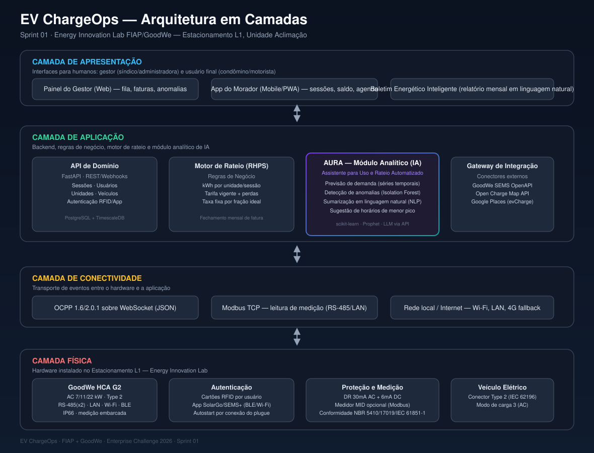
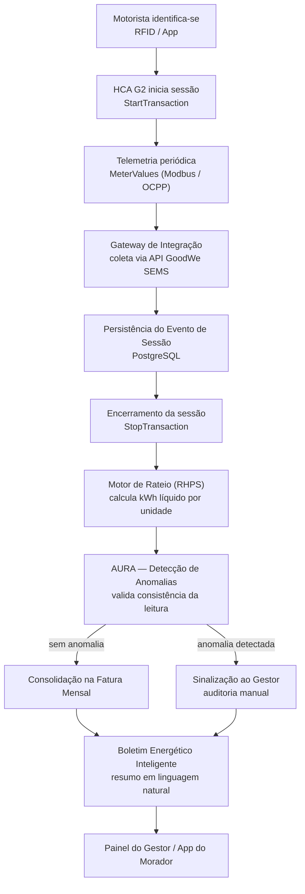
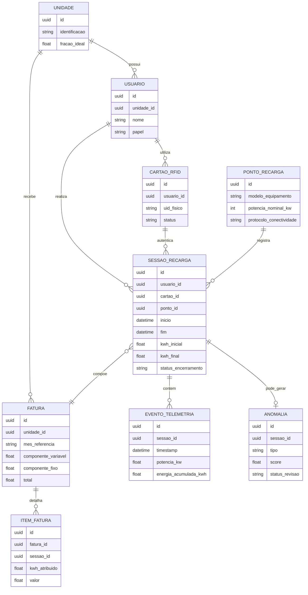

<div align="center">

# EV ChargeOps

### Inteligência operacional para recarga compartilhada de veículos elétricos

**FIAP Enterprise Challenge 2026 · GoodWe Energy Innovation Lab — Unidade Aclimação**


</div>

---

## Equipe

| Integrante | RM |
|---|---|
| Pedro de Oliveira Reis Sales | RM572709 |

**Repositório:** [github.com/PedroSales-dev/Challenge-GOODWE](https://github.com/PedroSales-dev/Challenge-GOODWE)

> Entregável da **Sprint 01** do EV Challenge 2026 (FIAP + GoodWe). Reúne a pesquisa das três frentes exigidas, a arquitetura proposta, o modelo de rateio, o papel da IA e o plano da Sprint 02. Sem código de produção nesta etapa — o objetivo é fixar as decisões que vão guiar o desenvolvimento.

---

## Sumário

1. [Contexto do Desafio](#1-contexto-do-desafio)
2. [Visão de Produto — EV ChargeOps](#2-visão-de-produto--ev-chargeops)
3. [Frente 1 — Contexto e Problema](#3-frente-1--contexto-e-problema)
4. [Frente 2 — Base Regulatória e Técnica](#4-frente-2--base-regulatória-e-técnica)
5. [Frente 3 — Arquitetura e IA](#5-frente-3--arquitetura-e-ia)
6. [Plano para a Sprint 02](#6-plano-para-a-sprint-02)
7. [Riscos, Premissas e Limites de Escopo](#7-riscos-premissas-e-limites-de-escopo)
8. [Stack Tecnológica Resumida](#8-stack-tecnológica-resumida)
9. [Estrutura do Repositório](#9-estrutura-do-repositório)
10. [Referências](#10-referências)

---

## 1. Contexto do Desafio

A GoodWe mantém, no Brasil, uma parceria com a FIAP através do **Energy Innovation Lab** (Unidade Aclimação), onde um carregador **GoodWe HCA G2** opera no estacionamento L1. Esse equipamento é o ponto de partida físico de um problema operacional concreto: **infraestruturas de recarga compartilhada — condomínios, edifícios corporativos, campus — não registram, de forma estruturada, quem carregou, quanto consumiu e quanto deve pagar.**

O problema é urgente porque o mercado cresceu rápido. Segundo a ABVE, o Brasil vendeu **223.912 veículos eletrificados em 2025**, alta de **26% sobre 2024** (177.358 unidades) — dez vezes o ritmo de crescimento do mercado automotivo total no período. A frota acumulada (2012–jan/2026) chega a **645.407 veículos**, com São Paulo concentrando 181.305 unidades. Em 2025, **81% dos eletrificados vendidos (181.542) eram plug-in** (BEV + PHEV): veículos que dependem de um ponto de recarga, cada vez mais a garagem de casa ou do trabalho, não um eletroposto público.

Esse volume de plug-in caindo sobre garagens coletivas é o que transforma recarga compartilhada de comodidade em problema de gestão: um único ponto de conexão, vários veículos, nenhum mecanismo nativo para dizer quem paga o quê. É esse vácuo de orquestração — não a tecnologia de carregamento em si, que já é madura — que o **EV ChargeOps** ataca.

---

## 2. Visão de Produto — EV ChargeOps

**EV ChargeOps** é a camada de software entre o hardware de recarga (GoodWe HCA G2 e equipamentos compatíveis) e quem depende dele para operar ou usar a infraestrutura — síndicos, administradoras, gestores de estacionamento corporativo, motoristas. Em uma frase: **transforma o evento físico "alguém plugou um carro" em consumo auditável, fatura individual justa e decisão operacional baseada em dados.**

O produto não compete com hardware nem com infraestrutura de pagamento de eletropostos comerciais — esse é o território da ChargeGrid Intelligence, descrita no playbook do desafio para o cenário de varejo. O EV ChargeOps ocupa o nicho **condominial e corporativo de uso compartilhado e não comercial**, onde o desafio não é cobrar o usuário final em tempo real, mas **ratear de forma justa um custo de energia entre vizinhos ou colegas de trabalho**.

### Proposta de valor

- **Gestor** — troca a discussão subjetiva sobre "quem usa a energia comum" por dados objetivos: fatura automática e relatório mensal em linguagem natural.
- **Morador/colaborador** — paga exatamente pelo que consumiu, com histórico de sessões e previsão de custo.
- **Operação** — antecipa picos de demanda e sinaliza anomalias antes que virem reclamação, autuação ou processo judicial entre condôminos — risco real, como mostra a Frente 2.

---

## 3. Frente 1 — Contexto e Problema

### 3.1 Infraestruturas de recarga compartilhada e seus desafios operacionais

Infraestrutura de recarga compartilhada é qualquer instalação cujo uso não é exclusivo de um único titular de unidade consumidora. Três cenários, três dinâmicas:

| Cenário | Quem compartilha | Fricção dominante |
|---|---|---|
| Condomínio residencial | Moradores de unidades distintas | Rateio de custo comum; quem paga por quem |
| Edifício corporativo | Colaboradores e visitantes | Política de benefício/reembolso; priorização de vagas |
| Campus/laboratório | Alunos, pesquisadores, parceiros | Acesso temporário sem unidade fixa; auditoria por sessão |

O desafio comum aos três é a falta de **registro por usuário** no nível da sessão. Um circuito que alimenta um carregador comum não distingue, por si só, o consumo do morador do bloco A do consumo do morador do bloco B. Sem essa distinção, sobram soluções manuais e falíveis: rodízio informal, planilha do zelador, ou — o caso mais comum em condomínios brasileiros hoje — diluir o custo da garagem na taxa condominial geral, penalizando quem não tem VE e subsidiando quem tem.

A isso se soma uma fricção regulatória nova: a insegurança jurídica sobre **segurança contra incêndio** em garagens com carregadores (detalhada na Frente 2) tem travado decisões de síndicos justamente quando a demanda por recarga residencial mais cresce.

### 3.2 Anatomia técnica de uma sessão de recarga

Uma sessão de recarga AC no HCA G2 segue uma sequência de eventos alinhada ao IEC 61851-1 (modo de carga 3) e, sob gestão remota, ao OCPP (Open Charge Point Protocol):

1. **Disponibilidade** — carregador energizado e em repouso, emitindo status (`StatusNotification`: *Available*).
2. **Identificação do usuário** — autenticação por cartão RFID, app (SolarGo/SEMS+) ou autostart por conexão do plugue. Este é o evento que **vincula a sessão a uma identidade**, pré-requisito de qualquer rateio justo.
3. **Conexão física** — veículo plugado (conector Type 2); o carregador negocia a corrente máxima com o módulo de carga embarcado.
4. **Início da transação** — energização liberada (`StartTransaction`), com timestamp e leitura inicial do medidor.
5. **Telemetria contínua** — leituras periódicas de potência (kW), energia acumulada (kWh) e alertas (sobrecorrente, sobretemperatura, falha de comunicação) — equivalente a `MeterValues`.
6. **Encerramento** — por decisão do usuário, carga completa ou desconexão do plugue; leitura final do medidor (`StopTransaction`).
7. **Consolidação** — a diferença entre leitura final e inicial é o **kWh líquido entregue**: o dado primário de qualquer rateio.

Esses dados chegam por dois canais complementares: localmente, via **RS-485/Modbus**, lendo registradores do carregador ou de um medidor MID adicional; remotamente, via **API GoodWe SEMS**, já tratados como dados de negócio (Frente 2). Essa dualidade — limite físico + nuvem — sustenta a camada de conectividade da arquitetura (Frente 3).

### 3.3 Modelos de negócio para recarga compartilhada

| Modelo | Como funciona | Onde se aplica bem | Limitação principal |
|---|---|---|---|
| **Recarga gratuita** | Custo absorvido pela operação | Baixa adesão de VEs; benefício de retenção corporativa | Não escala; gera disputa quando a adesão cresce |
| **Cobrança por kWh** | Tarifa sobre energia medida no equipamento | Modelo mais justo tecnicamente | Exige medição confiável e, às vezes, credenciamento metrológico |
| **Cobrança por tempo de conexão** | Tarifa por minuto de uso | Eletropostos de giro rápido, onde a vaga é o ativo escasso | Penaliza carga lenta; é a modalidade mais criticada por usuários — eletropostos comerciais cobrando por minuto independentemente da potência entregue geram reclamação recorrente |
| **Assinatura mensal fixa** | Valor fixo, com ou sem teto de uso | Frotas corporativas previsíveis | Injusta em uso heterogêneo (uso diário vs. mensal) |
| **Rateio diluído na taxa comum** | Custo da garagem embutido na taxa condominial geral | Transição, sem carregadores inteligentes | É o modelo que gera a injustiça percebida que motiva este desafio |

Premissa de design do EV ChargeOps: **a única base tecnicamente defensável e socialmente aceitável para recarga compartilhada residencial é a cobrança por kWh efetivamente consumido**, somada a um componente fixo de manutenção rateado por critério condominial já existente (fração ideal). O modelo completo está na Frente 3.

### 3.4 Aprofundamento escolhido — Opção A: Análise de Mercado

A pesquisa combina as referências sugeridas no playbook (Zaptec, Wallbox Pulsar Plus, ChargePoint, Neocharge, Copel Telecom EV) com duas soluções **brasileiras desenhadas para condomínio** (Power2Go, WEG WEMOB), mais comparáveis ao escopo do EV ChargeOps do que players globais de uso doméstico unifamiliar.

| Solução | Problema que resolve | Funcionalidades principais | Modelo de negócio | Limitações |
|---|---|---|---|---|
| **Zaptec** (Noruega) | Balanceamento dinâmico de carga em circuito limitado | Algoritmo proprietário de balanceamento de fases; dezenas de carregadores em um circuito de baixa amperagem | Hardware próprio + plataforma de gestão | Ecossistema fechado; integração com carregadores de terceiros (como o HCA G2) não é nativa |
| **Wallbox Pulsar Plus** | Carregamento inteligente residencial unifamiliar | App myWallbox, agendamento por tarifa, compartilhamento entre duas unidades Pulsar | Hardware + app gratuito | Pensado para uma garagem por contrato; não resolve rateio entre unidades distintas |
| **ChargePoint** | Operação de redes de recarga em escala | Gestão de frota e rede, histórico detalhado por sessão | Hardware + assinatura de rede | Cada unidade exige circuito dedicado; presença reduzida no Brasil |
| **Neocharge** | Múltiplos carregadores em circuito subdimensionado | "Smart Splitter" (hardware) + app de monitoramento | Venda de splitter + app freemium | Resolve viabilidade elétrica, não rateio financeiro entre titulares |
| **Copel Telecom EV** (eletropostos) | Recarga comercial cobrada por tempo de uso | Eletropostos com cobrança via app/cartão | Exploração comercial direta (tarifa por minuto) | Cobrança por tempo gera insatisfação quando a potência varia; não trata rateio coletivo |
| **Power2Go** (Brasil) | Rateio de energia em carregador compartilhado de condomínio | Mede consumo por carregador e envia ao síndico (Power2Go Direct) ou cobra direto o morador (Power2Go Pay) | Taxa de gestão sobre o serviço | Concorrente mais próximo; depende de OCPP no carregador; sem IA preditiva ou de anomalias |
| **WEG WEMOB** (Brasil) | Estação de recarga proprietária com rateio e cobrança integrados | Hardware homologado Inmetro + app WEMOB EV Drivers | Hardware WEG + plataforma própria | Verticalizado ao próprio hardware; não orquestra carregadores de terceiros |

**Lacuna de mercado.** Nenhuma solução combina as três características que o EV ChargeOps propõe juntas: (1) **agnóstica de hardware** o suficiente para operar sobre o ecossistema GoodWe via protocolos abertos (OCPP/Modbus); (2) trata **rateio condominial** como problema central, não subproduto de uma plataforma de cobrança comercial; (3) usa **IA preditiva e analítica** como núcleo do produto, não como recurso acessório. Hardware aberto + rateio justo + IA como motor de decisão: esse é o espaço livre.

---

## 4. Frente 2 — Base Regulatória e Técnica

### 4.1 Resolução Normativa ANEEL nº 1.000/2021

Em vigor desde dezembro de 2021, a REN 1.000/2021 consolidou mais de 60 resoluções anteriores, entre elas a REN 414/2010 e a REN 819/2018 (recarga de VEs). O **Capítulo V** trata diretamente de instalações de recarga e sustenta três pilares da viabilidade legal do EV ChargeOps:

- **Exploração comercial livre.** A recarga de veículo de terceiro é permitida, inclusive para exploração comercial a preços livremente negociados. Um condomínio pode cobrar legalmente um morador pelo uso compartilhado de um carregador, sem outorga específica da ANEEL — o rateio da Frente 3 está amparado por essa permissão.
- **Comunicação prévia à distribuidora.** Instalação que altere carga ou tensão relevante deve ser comunicada previamente, no pedido de ligação ou análise de projeto. Obrigação da instalação física, não do software — mas o EV ChargeOps mantém esse registro disponível para auditoria do gestor.
- **Protocolos abertos obrigatórios.** Equipamentos não exclusivos de uso privado — o caso de um carregador compartilhado — precisam de protocolo aberto de domínio público para supervisão e controle remoto. Essa exigência é a base legal, não apenas técnica, para adotar **OCPP** como protocolo de conectividade na Frente 3.

A norma também veda a injeção de energia do veículo para a rede (sem V2G amplo), permitindo fluxo bidirecional apenas restrito à mesma unidade consumidora — relevante caso o roadmap futuro considere *vehicle-to-home*.

### 4.2 Carregador GoodWe HCA G2 — interfaces de comunicação

O HCA G2 vem em três potências (7 kW monofásico; 11 e 22 kW trifásico), conector Type 2, cabo de 7,5 m, IP66 e disjuntor residual combinado de 30 mA AC + 6 mA DC. Suas cinco interfaces de comunicação têm papéis distintos na arquitetura:

| Interface | Função técnica | Uso no EV ChargeOps |
|---|---|---|
| **RS-485 (×2, Modbus)** | Comunicação serial industrial de baixa latência | Canal primário de leitura de potência/energia, alimenta motor de rateio e detecção de anomalias |
| **LAN (Ethernet)** | Conectividade IP cabeada e estável | Canal recomendado para o gateway OCPP em produção |
| **Wi-Fi** | Conectividade IP sem fio | Canal de instalação e fallback |
| **Bluetooth** | Conectividade de curto alcance | Pareamento inicial com o app SolarGo/SEMS+ na instalação |
| **RFID (leitor integrado)** | Identificação física por aproximação | Mecanismo central de **vínculo identidade–sessão**; sem ele, não há como atribuir consumo a uma unidade |

### 4.3 API GoodWe (SEMS Portal)

A GoodWe expõe três tipos de API:

1. **OpenAPI** — contas organizacionais SEMS; acesso completo aos dispositivos da organização, consulta de dados de negócio e controle remoto. Organizada em quatro famílias: planta, dispositivo, controle remoto, datalogger.
2. **Real-time Data Monitoring API** — para terceiros que precisam de dados brutos em tempo real, sem cadastrar a planta no SEMS: o terceiro registra os equipamentos em whitelist e obtém autorização do usuário final.
3. **Batch Remote Control Interface** — comandos a múltiplos equipamentos simultaneamente (sem atualização de firmware).

A autenticação segue o padrão `CrossLogin` (`POST /api/v1/Common/CrossLogin`), que devolve um token usado nas chamadas seguintes — por exemplo, `GetMonitorDetailByPowerstationId`. Payload típico de evento, simplificado:

```json
{
  "status": "active",
  "power": "11kW",
  "timestamp": "2026-05-23T10:15:00Z"
}
```

Para o EV ChargeOps, a **OpenAPI** é o serviço de referência: entrega potência, energia e eventos de sessão já tratados, sem exigir parsing de registradores Modbus brutos. O backend trata a API GoodWe como fonte de verdade da telemetria; o canal RS-485/Modbus local funciona como redundância de menor latência para a detecção de anomalias.

### 4.4 Aprofundamento escolhido — Opção A: Mapeamento Regulatório Completo (São Paulo)

Além da REN 1.000/2021, há um movimento regulatório estadual em curso em São Paulo, ativo no exato período desta sprint:

**Lei estadual nº 18.403/2026.** Assegura ao condômino o direito de instalar, às próprias expensas, uma estação de recarga individual em sua vaga privativa, condicionado a normas técnicas e de segurança vigentes. Antes da lei, a decisão dependia da convenção do condomínio e de assembleia, com jurisprudência majoritariamente desfavorável ao morador. A lei não dispensa aprovação técnica, mas retira do síndico o veto arbitrário.

**Portarias do Corpo de Bombeiros de SP (CCB-008/800/2025 e CCB-009/800/2025, nov/2025).** Em resposta ao debate sobre risco de incêndio em garagens com VEs — que paralisou decisões de incorporadoras em 2024–2025 —, o Corpo de Bombeiros colocou em consulta pública a revisão da **IT-41**, com exigências para **Sistemas de Alimentação de Veículos Elétricos (SAVE)**, alinhadas à Diretriz Nacional da LIGABOM:

- Instalação por responsável técnico com ART, seguindo **NBR 5410**, **NBR 17019** e **NBR IEC 61851-1**, com estudo de curva de carga;
- Em áreas internas, apenas **modos de recarga 3 e 4** (AC tipo wallbox e DC) — valida diretamente o HCA G2 (modo 3) como equipamento compatível;
- Circuito exclusivo por ponto de recarga, com disjuntor, DR e DPS dedicados; proibidas tomadas comuns, extensões ou adaptadores;
- Chaves de desligamento de emergência e sinalização fotoluminescente padronizada;
- Proibida conexão direta ao padrão de entrada; afastamento mínimo de proteção contra impacto de veículos.

**Conformidade do EV ChargeOps.** Essas exigências são de instalação elétrica física, fora do escopo de software. O EV ChargeOps contribui em dois pontos: (a) registra metadados de conformidade por ponto de recarga (data da ART, responsável técnico, norma de referência), auditáveis em vistoria; (b) sua camada de conectividade, por depender de OCPP e Modbus, já atende nativamente à exigência de protocolo aberto da REN 1.000/2021. Não há incompatibilidade entre a arquitetura proposta e o cenário regulatório paulista — pelo contrário: o foco do produto em registro por sessão e auditabilidade é diferencial competitivo justamente agora, com documentação técnica virando pré-condição de aprovação.

---

## 5. Frente 3 — Arquitetura e IA

### 5.1 Camadas da plataforma

Quatro camadas, ilustradas no diagrama abaixo (`docs/diagrams/arquitetura-evchargeops.svg`):



| Camada | Responsabilidade | Componentes-chave |
|---|---|---|
| **Física** | Conversão de energia e captura do evento bruto | GoodWe HCA G2, leitor RFID, medidor MID opcional, proteções elétricas |
| **Conectividade** | Transporte do evento até a aplicação | OCPP 1.6/2.0.1 (WebSocket/JSON), Modbus TCP, rede local/Internet |
| **Aplicação** | Regras de negócio, persistência, rateio e IA | API de domínio (FastAPI), Motor de Rateio (RHPS), Aura (IA), Gateway de integração |
| **Apresentação** | Interfaces humanas | Painel do gestor, app do morador, Boletim Energético Inteligente |

A divisão em camadas — e não um monólito — permite que, na Sprint 02, o **carregador físico do Lab FIAP** entre via dados reais da API GoodWe enquanto o restante evolui sobre dados simulados, sem acoplar fonte de dados e lógica de negócio.

### 5.2 Fluxo de dados — da sessão de recarga à fatura



A IA entra em dois pontos: validação de consistência (antes da fatura fechar) e tradução final em linguagem acessível (depois). Não é camada decorativa — é parte do caminho crítico de garantia de qualidade do dado faturado.

### 5.3 Modelo de rateio proposto — RHPS (Rateio Híbrido Proporcional por Sessão)

A infraestrutura tem custo fixo (existir, estar disponível, ser mantida) e custo variável (energia consumida). O modelo combina os dois:

```
Fatura_unidade(mês) = Componente_Variável + Componente_Fixo

Componente_Variável = Σ(kWh_sessão) × Tarifa_vigente × (1 + Fator_perda_interna)

Componente_Fixo = Custo_manutenção_infraestrutura × Fração_ideal_unidade
```

**Variáveis:**

| Variável | Origem do dado | Observação |
|---|---|---|
| `kWh_sessão` | Diferença entre leitura final e inicial, por sessão, vinculada ao RFID/usuário | Soma todas as sessões de todos os RFIDs da mesma unidade no período |
| `Tarifa_vigente` | Tarifa da distribuidora local, com bandeira tarifária do mês | Pode incorporar tarifa branca por horário no futuro |
| `Fator_perda_interna` | Perdas técnicas estimadas na instalação interna (2–5%) | Parametrizável por instalação; calibrado na Sprint 02 com dados do Lab FIAP |
| `Custo_manutenção_infraestrutura` | Custo fixo mensal definido em assembleia | Rateado pelo critério **já existente no condomínio** (fração ideal, art. 1.336 do Código Civil) — o produto não cria critério novo, aplica o que já existe |

**Casos excepcionais:**

- **Sessão interrompida** (queda de energia, falha de comunicação, desconexão abrupta): a sessão fecha como "órfã" no último `MeterValues` válido, com flag de incerteza. O kWh parcial medido entra no rateio normalmente — nenhuma energia entregue deixa de ser contabilizada — mas a sessão fica marcada para auditoria se o valor divergir do padrão histórico da unidade (acionando a detecção de anomalias).
- **Usuário sem recarga no mês** — componente variável zero; o componente fixo de manutenção é cobrado normalmente, pois a disponibilidade da infraestrutura beneficia todos, com ou sem uso — a mesma lógica do rateio de manutenção do elevador para quem mora no térreo.
- **Duas unidades com dois veículos (ou uma unidade com dois)** — o rateio nunca é por vaga ou por carregador, é **por usuário identificado**, agregado à unidade vinculada no cadastro. O modelo de dados (Seção 5.5) suporta relação N:N entre usuários/cartões RFID e unidade; consumo de cartões distintos da mesma unidade soma automaticamente.

### 5.4 Aprofundamento escolhido — Opção B: O Papel da IA na Solução

A IA é tratada como **motor lógico**, não como funcionalidade cosmética. O módulo recebeu nome próprio: **Aura** (*Assistente para Uso e Rateio Automatizado*), com três abordagens:

**1. Previsão de consumo e demanda (séries temporais).**
- *Problema*: antecipar, por ponto e janela horária, a demanda agregada de potência, evitando que vários veículos carregando juntos excedam a demanda contratada.
- *Técnica*: séries temporais (Prophet, ou *gradient boosting* sobre features de calendário) treinadas no histórico de sessões.
- *Dados*: timestamp de início/fim, kWh, unidade, calendário (dia da semana, feriados), e dados meteorológicos quando houver geração solar.
- *Impacto*: recomendação proativa de horário ao morador (custo menor em tarifa branca) e alerta ao gestor sobre revisão de demanda contratada — evita o disjuntor geral desarmando por sobrecarga não prevista.

**2. Detecção de anomalias (aprendizado não supervisionado).**
- *Problema*: identificar sessões cujo consumo, duração ou potência diverge do histórico — sinal de falha de medição, fraude (RFID emprestado/clonado) ou degradação do hardware.
- *Técnica*: Isolation Forest (ou Z-score multivariado como baseline) sobre kWh, duração, potência média e horário.
- *Dados*: histórico de sessões, com rótulo manual retroativo de casos já identificados pelo gestor.
- *Impacto*: sinaliza a sessão suspeita antes de cobrar, não depois da reclamação.

**3. Sumarização em linguagem natural.**
- *Problema*: a maioria dos síndicos não tem formação técnica para interpretar um painel de métricas; a Aura traduz os números do mês em um parágrafo — o **Boletim Energético Inteligente**.
- *Técnica*: geração de texto via API de LLM com prompt parametrizado pelos dados do mês (sem fine-tuning na Sprint 02), com template de fallback determinístico.
- *Dados*: saídas já consolidadas das duas abordagens anteriores, mais totais de fatura.
- *Impacto*: menos tempo interpretando dados brutos; maior adesão de administradoras que hoje evitam soluções "complexas demais".

### 5.5 Aprofundamento escolhido — Opção C: Esquema da Base de Dados

Desenhado para sustentar rateio (5.3) e IA (5.4) ao mesmo tempo, já prevendo as necessidades de histórico da Sprint 02.



**Registro simulado — sessão de recarga:**

```json
{
  "id": "f3a1c2e0-91d4-4b2e-9a7f-2e1c8d4f0a11",
  "usuario_id": "9c2b1e44-0a3d-4f7a-bf2e-1d8c5a6e9201",
  "cartao_id": "7d4e2a19-8b3c-4f1e-9a0d-3c2b1e445566",
  "ponto_id": "a1b2c3d4-e5f6-4789-90ab-cdef01234567",
  "inicio": "2026-06-10T19:42:11Z",
  "fim": "2026-06-10T23:58:47Z",
  "kwh_inicial": 1042.7,
  "kwh_final": 1054.3,
  "status_encerramento": "concluida_normal"
}
```

**Registro simulado — anomalia detectada:**

```json
{
  "id": "0e4f9a22-7c1b-4d5e-bb3a-9f0e1c2d3456",
  "sessao_id": "f3a1c2e0-91d4-4b2e-9a7f-2e1c8d4f0a11",
  "tipo": "consumo_acima_do_padrao_historico",
  "score": 0.87,
  "status_revisao": "pendente"
}
```

Esquema a ser implementado em PostgreSQL na Sprint 02, com TimescaleDB avaliado para `EVENTO_TELEMETRIA`, dado seu padrão de escrita intensiva em série temporal.

---

## 6. Plano para a Sprint 02

Quatro blocos sequenciais, cada um com incremento testável, prazo 20/09/2026:

| Bloco | Entregável | Tecnologias | Critério de pronto |
|---|---|---|---|
| **1. Fundação de dados** | Banco conforme o esquema da Seção 5.5; simulador de eventos baseado no dataset Kaggle *Electric Vehicle Charging Sessions* e em dados reais do HCA G2 do Lab FIAP, quando disponíveis | PostgreSQL + TimescaleDB, Python | Banco com 90+ dias de sessões simuladas e/ou reais, consultável |
| **2. Motor de rateio (RHPS)** | API que calcula a fatura mensal por unidade, com os três casos excepcionais tratados | Python + FastAPI, pytest | Testes dos três casos excepcionais passando; fatura correta para um mês simulado |
| **3. Camada Aura (IA)** | Modelos de previsão de demanda e detecção de anomalias; integração de LLM para o Boletim Energético Inteligente | scikit-learn, Prophet/statsmodels, API de LLM | Modelo identifica outliers injetados artificialmente; boletim gerado para um mês de teste |
| **4. Interfaces e integração** | Painel do gestor e visão do morador; gateway com a API GoodWe SEMS (sandbox, já que produção exige credenciamento comercial) e mock de servidor OCPP | React + Tailwind, Recharts, biblioteca `ocpp` (Python) | Fluxo ponta a ponta demonstrável: sessão → fatura → boletim → painel |

**Ordem e racional.** Dados primeiro, porque rateio e IA dependem de um modelo estável. Rateio antes da IA, porque a detecção de anomalias precisa de um cálculo de referência para comparar. Interfaces por último, porque consomem as APIs anteriores. A integração com o hardware físico do Lab FIAP é perseguida ao longo de toda a sprint, condicionada ao credenciamento da API GoodWe — se não for viabilizada a tempo, o pitch final roda sobre o simulador, sem prejuízo da avaliação do raciocínio arquitetônico, que o próprio playbook define como foco da banca.

---

## 7. Riscos, Premissas e Limites de Escopo

| Item | Natureza | Tratamento adotado |
|---|---|---|
| Acesso de produção à API GoodWe SEMS depende de credenciamento comercial | Risco externo | Sprint 02 desenvolve sobre simulador com schema idêntico ao real, trocável sem refatoração |
| IT-41 (Corpo de Bombeiros) ainda em consulta pública | Risco regulatório, fora de controle | Conformidade tratada como metadado auditável, não requisito de software; revisão acompanhada até a Sprint 02 |
| Tarifa horária (branca) não é universal entre distribuidoras | Premissa de simplificação | Rateio inicial assume tarifa única; dado já suporta tarifa por horário para evolução futura |
| Detecção de anomalias com poucos dados reais gera falsos positivos | Risco técnico de IA | Treino inicial em dataset público (Kaggle) + outliers injetados artificialmente para validação |
| Geração de linguagem natural via LLM externo depende de terceiro | Risco de arquitetura | Template determinístico de fallback garante boletim sempre disponível, só menos elaborado |

---

## 8. Stack Tecnológica Resumida

| Camada | Tecnologia | Justificativa |
|---|---|---|
| Backend / API | Python + FastAPI | Documentação automática (OpenAPI), produtividade adequada ao prazo |
| Banco de dados | PostgreSQL + TimescaleDB | Modelo relacional + extensão otimizada para série temporal |
| IA / Machine Learning | scikit-learn, Prophet/statsmodels | Bibliotecas maduras para previsão e detecção de anomalias |
| Conectividade com hardware | Biblioteca `ocpp` (Python), `pymodbus` | Implementações abertas e testadas dos dois protocolos exigidos |
| Frontend | React + Tailwind CSS + Recharts | Produtividade de UI e visualização de série temporal |
| Integrações externas | API GoodWe SEMS (OpenAPI), Open Charge Map API | Telemetria e contexto geográfico de recarga |
| Infraestrutura | Docker / Docker Compose | Ambiente reprodutível entre equipe e banca |

---

## 9. Estrutura do Repositório

```
Challenge-GOODWE/
├── README.md                                  ← este documento
└── docs/
    └── diagrams/
        └── arquitetura-evchargeops.svg        ← diagrama referenciado na Seção 5.1
```

Expandida na Sprint 02 com `backend/`, `frontend/`, `ia/` e `infra/`, conforme os blocos da Seção 6.

---

## 10. Referências

Todas as fontes abaixo foram efetivamente consultadas.

**Regulação e legislação**
- ANEEL. *Resolução Normativa nº 1.000, de 7 de dezembro de 2021.* https://www2.aneel.gov.br/cedoc/ren20211000.html
- ANEEL. *Veículos Elétricos.* https://www.gov.br/aneel/pt-br/assuntos/veiculos-eletricos
- SECOVI-SP. *Corpo de Bombeiros publica novas Portarias para segurança em garagens com veículos elétricos.* https://secovi.com.br/corpo-de-bombeiros-publica-novas-portarias-para-seguranca-em-garagens-com-veiculos-eletricos/
- Lello Condomínios. *Veículos elétricos em condomínios: normas e instalação.* https://www.lellocondominios.com.br/veiculos-eletricos-em-condominios-o-que-diz-a-legislacao-como-instalar-e-quais-cuidados-os-sindicos-precisam-ter/
- Migalhas. *Carregadores de veículos em condomínios e a nova lei de SP.* https://www.migalhas.com.br/depeso/450429/carregadores-de-veiculos-em-condominios-e-a-nova-lei-de-sp
- Diário Oficial do Estado de São Paulo. *Portarias CCB-008/800/2025 e CCB-009/800/2025.* https://cbaplang.corpodebombeiros.sp.gov.br/Midias/638986232326891879.pdf
- ABVE. *Bombeiros esclarecem: estações de recarga corretamente instaladas não comprometem emissão do AVCB.* https://abve.org.br/bombeiros-de-sp-esclarecem-estacoes-de-recarga-corretamente-instaladas-em-edificios-nao-comprometem-emissao-do-avcb/

**Mercado e frota de veículos elétricos**
- ABVE. *Eletrificados crescem dez vezes mais do que o conjunto do mercado, e vendas chegam a 224 mil veículos em 2025.* https://abve.org.br/eletrificados-crescem-dez-vezes-mais-do-que-conjunto-do-mercado-em-2025-com-224-mil-veiculos-vendidos/
- SMABC. *Frota de eletrificados no Brasil se aproxima dos 650 mil veículos.* https://smabc.org.br/frota-de-eletrificados-no-brasil-se-aproxima-dos-650-mil-veiculos/

**Carregador e API GoodWe**
- GoodWe. *Datasheet HCA G2 Series EV Charger.* https://en.goodwe.com/Ftp/EN/Downloads/Datasheet/GW_HCA-G2_Datasheet-EN.pdf
- GoodWe. *User Manual AC Charger HCA Series (7–22 kW) G2.* https://www.mg-solar-shop.com/media/pdf/1c/ed/c9/user_manual_goodwe_hca_g2_v1.pdf
- GoodWe Community. *API Introduction.* https://community.goodwe.com/solution/API%20introduction
- GoodWe Community. *GoodWe API Technical Document.* https://community.goodwe.com/static/images/2024-08-20597794.pdf
- Karunanayake, B. *Accessing GoodWe Sems Portal API: A Comprehensive Guide.* Medium. https://binodmx.medium.com/accessing-the-goodwe-sems-portal-api-a-comprehensive-guide-296e0431c285

**APIs complementares**
- Open Charge Map. *API Documentation.* https://www.openchargemap.org/develop/api
- OpenPublicAPIs. *Open Charge Map.* https://openpublicapis.com/api/open-charge-map

**Soluções de mercado analisadas**
- Power2Go. *Recarga de Carros Elétricos.* https://www.power2go.com.br/recarga-de-carros-eletricos
- WEG Digital & Sistemas. *Cobrança automática para carregadores de veículos elétricos em condomínios.* https://www.weg.net/digital/blog/gateway-de-pagamento-para-carregadores-veiculos-eletricos-condominios/
- Wallbox. *Pulsar Plus EV Charger.* https://wallbox.com/en_us/pulsar-plus-ev-charger
- NeoCharge. *Estação de Recarga Veículo Elétrico.* https://www.neocharge.com.br/tudo-sobre/carregador-carro-eletrico/estacao-recarga-veiculo-eletrico
- ChaZeMo. *Carregador Veículo Elétrico (Zaptec).* https://www.chazemo.com/

**Material do desafio**
- FIAP / GoodWe. *1CC — EV Challenge GoodWe FIAP 2026* (enunciado da Sprint 01) e *EV Challenge 2026 — Playbook Oficial*, materiais fornecidos pela coordenação do Enterprise Challenge 2026.

---

<div align="center">

**EV ChargeOps** · Enterprise Challenge 2026 · FIAP + GoodWe Energy Innovation Lab

</div>
