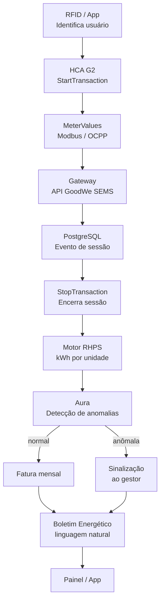
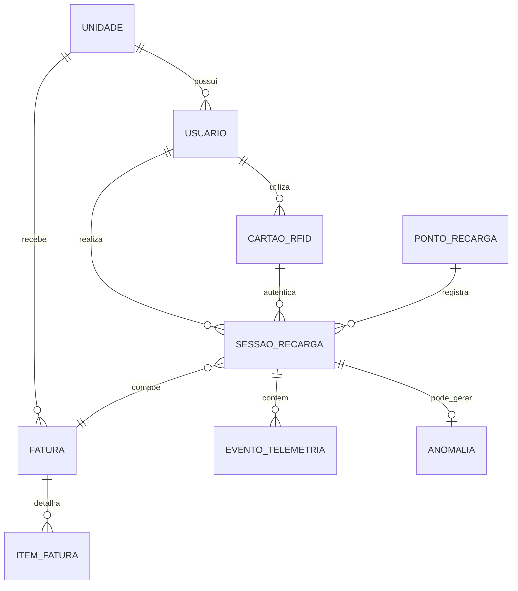

<div align="center">

# EV ChargeOps

### Inteligência operacional para recarga compartilhada de veículos elétricos

**FIAP Enterprise Challenge 2026 · GoodWe Energy Innovation Lab — Unidade Aclimação**


-475569)


</div>

---

## Equipe

| Integrante | RM |
|---|---|
| Pedro de Oliveira Reis Sales | RM572709 |

**Repositório:** [github.com/PedroSales-dev/Challenge-GOODWE](https://github.com/PedroSales-dev/Challenge-GOODWE)

---

## Sumário

1. [Contexto do Desafio](#1-contexto-do-desafio)
2. [Visão de Produto — EV ChargeOps](#2-visão-de-produto--ev-chargeops)
3. [Sprint 01 — Pesquisa e Documentação](#3-sprint-01--pesquisa-e-documentação)
   - 3.1 [Frente 1 — Contexto e Problema](#31-frente-1--contexto-e-problema)
   - 3.2 [Frente 2 — Base Regulatória e Técnica](#32-frente-2--base-regulatória-e-técnica)
   - 3.3 [Frente 3 — Arquitetura e IA](#33-frente-3--arquitetura-e-ia)
4. [Sprint 02 — Protótipo Funcional](#4-sprint-02--protótipo-funcional)
   - 4.1 [Como executar](#41-como-executar)
   - 4.2 [Estrutura do repositório](#42-estrutura-do-repositório)
   - 4.3 [Lógica central — Motor RHPS](#43-lógica-central--motor-rhps)
   - 4.4 [Módulo de IA — Aura](#44-módulo-de-ia--aura)
   - 4.5 [API REST — FastAPI](#45-api-rest--fastapi)
   - 4.6 [Dashboard — Frontend](#46-dashboard--frontend)
   - 4.7 [Evidências de funcionamento](#47-evidências-de-funcionamento)
   - 4.8 [Desvios em relação à Sprint 01](#48-desvios-em-relação-à-sprint-01)
5. [Referências](#5-referências)

---

## 1. Contexto do Desafio

A GoodWe mantém, no Brasil, uma parceria com a FIAP através do **Energy Innovation Lab** (Unidade Aclimação), onde um carregador **GoodWe HCA G2** opera no estacionamento L1. O problema operacional concreto: **infraestruturas de recarga compartilhada — condomínios, edifícios corporativos, campus — não registram, de forma estruturada, quem carregou, quanto consumiu e quanto deve pagar.**

O mercado torna o problema urgente. A ABVE registrou **223.912 veículos eletrificados vendidos em 2025** (+26% sobre 2024), com 81% sendo plug-in. A frota acumulada chega a 645.407 unidades, com São Paulo concentrando 181.305 veículos. Esse volume caindo sobre garagens coletivas — sem nenhum mecanismo nativo de rateio — é o que o EV ChargeOps resolve.

---

## 2. Visão de Produto — EV ChargeOps

**EV ChargeOps** é a camada de software entre o hardware de recarga (GoodWe HCA G2) e quem depende dele para operar ou usar a infraestrutura. Em uma frase: **transforma o evento físico "alguém plugou um carro" em consumo auditável, fatura individual justa e decisão operacional baseada em dados.**

O produto ocupa o nicho **condominial e corporativo compartilhado** — não compete com plataformas de cobrança de eletropostos comerciais. O diferencial está na combinação de três características que nenhuma solução mapeada oferece em conjunto: (1) agnóstica de hardware via protocolos abertos (OCPP/Modbus), (2) rateio condominial como problema de primeira classe e (3) IA com função estrutural no fluxo, não decorativa.

---

## 3. Sprint 01 — Pesquisa e Documentação

### 3.1 Frente 1 — Contexto e Problema

Uma infraestrutura de recarga compartilhada é qualquer instalação cujo uso não é exclusivo de um único titular de unidade consumidora. Três cenários, três dinâmicas:

| Cenário | Quem compartilha | Fricção dominante |
|---|---|---|
| Condomínio residencial | Moradores de unidades distintas | Rateio de custo comum; quem paga por quem |
| Edifício corporativo | Colaboradores e visitantes | Política de benefício/reembolso; priorização de vagas |
| Campus/laboratório | Alunos, pesquisadores, parceiros | Acesso temporário sem unidade fixa; auditoria por sessão |

**Anatomia de uma sessão de recarga.** Uma sessão AC no HCA G2 segue o IEC 61851-1 (modo 3) e, sob gestão remota, o OCPP: (1) disponibilidade, (2) identificação por RFID/app — que vincula a sessão a uma identidade —, (3) conexão física, (4) `StartTransaction` com timestamp e leitura inicial do medidor, (5) `MeterValues` periódicos, (6) `StopTransaction` com leitura final. A diferença entre leitura final e inicial é o **kWh líquido entregue**, o dado primário de qualquer rateio.

**Modelos de negócio mapeados:**

| Modelo | Onde se aplica bem | Limitação |
|---|---|---|
| Recarga gratuita | Adesão baixa; benefício de retenção corporativa | Não escala com a frota |
| Cobrança por kWh | Modelo mais justo; base do EV ChargeOps | Exige medição confiável |
| Cobrança por tempo | Eletropostos de giro rápido | Penaliza carga lenta; insatisfação recorrente |
| Assinatura mensal | Frotas corporativas previsíveis | Injusta em uso heterogêneo |
| Rateio diluído na taxa | Condomínios sem carregadores inteligentes | Gera o conflito que este produto resolve |

**Análise de mercado (Opção A).** Seis soluções mapeadas: Zaptec, Wallbox Pulsar Plus, ChargePoint, Neocharge, Power2Go e WEG WEMOB. Nenhuma combina simultaneamente: (1) agnóstica de hardware para o ecossistema GoodWe via OCPP/Modbus, (2) rateio condominial como problema central e (3) IA preditiva e analítica no núcleo — esse é o espaço do EV ChargeOps.

---

### 3.2 Frente 2 — Base Regulatória e Técnica

**REN ANEEL nº 1.000/2021.** Três pilares para a viabilidade legal do EV ChargeOps: (1) exploração comercial livre — condomínio pode cobrar morador sem outorga específica; (2) comunicação prévia à distribuidora em alterações de carga — responsabilidade da instalação física; (3) **protocolos abertos obrigatórios** para equipamentos não exclusivos de uso privado — fundamento legal, não apenas técnico, para adoção de OCPP.

**GoodWe HCA G2 — interfaces de comunicação:**

| Interface | Uso no EV ChargeOps |
|---|---|
| RS-485 / Modbus (×2) | Leitura de potência/energia em baixa latência; redundância local |
| LAN (Ethernet) | Canal principal do gateway OCPP em produção |
| Wi-Fi | Instalação e fallback |
| Bluetooth | Pareamento inicial com o app SolarGo/SEMS+ |
| RFID (leitor integrado) | Vínculo identidade–sessão — pré-requisito do rateio |

**API GoodWe SEMS (OpenAPI).** Autenticação via `CrossLogin`; endpoints `GetMonitorDetailByPowerstationId` e família device entregam potência, energia e eventos de sessão já tratados. Payload típico: `{"status":"active","power":"11kW","timestamp":"2026-06-10T19:42:00Z"}`. No protótipo, a API é simulada por um gerador de dados sintéticos com o mesmo schema.

**Mapeamento regulatório São Paulo (Opção A).** Dois achados relevantes além da REN 1.000/2021:
- **Lei estadual SP 18.403/2026** — assegura ao condômino o direito de instalar estação de recarga individual na vaga privativa, retirando o veto arbitrário do síndico.
- **Portarias CCB-008/800/2025 e CCB-009/800/2025** (nov/2025) — revisão da IT-41, com exigências para SAVE (Sistemas de Alimentação de Veículos Elétricos): instalação por responsável técnico com ART (NBR 5410 / 17019 / IEC 61851-1), apenas modos 3 e 4 em áreas internas, circuito exclusivo por ponto. O HCA G2 (modo 3) é compatível. O EV ChargeOps responde registrando os metadados de conformidade como campo auditável no cadastro de cada ponto.

---

### 3.3 Frente 3 — Arquitetura e IA

**Diagrama de arquitetura em camadas:**


| Camada | Responsabilidade | Componentes |
|---|---|---|
| Física | Conversão de energia e captura do evento bruto | GoodWe HCA G2, RFID, proteções elétricas |
| Conectividade | Transporte até a aplicação | OCPP 1.6/2.0.1 (WebSocket/JSON), Modbus TCP |
| Aplicação | Regras de negócio, rateio e IA | FastAPI, Motor RHPS, Aura, Gateway GoodWe SEMS |
| Apresentação | Interfaces humanas | Painel gestor, app morador, Boletim Energético |

**Fluxo de dados:**



**Modelo de rateio RHPS (Opção A + B):**

```
Fatura(unidade, mês) = Componente_Variável + Componente_Fixo

Componente_Variável = Σ(kWh_sessão) × R$0,6878/kWh × 1,03
Componente_Fixo     = R$500/mês × fração_ideal_unidade
```

Três casos excepcionais tratados: sessão interrompida (kWh parcial contabilizado, flag de auditoria), unidade sem recarga (fixo cobrado, variável zero), múltiplos cartões/veículos por unidade (consumo somado automaticamente, fatura única).

**Módulo Aura — papel da IA (Opção B):**

| Abordagem | Técnica | Problema resolvido |
|---|---|---|
| Previsão de demanda | Holt-Winters (sazonalidade semanal) | Antecipar picos; sugerir horários de menor custo |
| Detecção de anomalias | Isolation Forest (4 features) | Flaggear sessões suspeitas antes do faturamento |
| Boletim energético | Geração por template (NLP) | Traduzir dados técnicos em linguagem natural para o gestor |

**Esquema de dados (Opção C):**



---

## 4. Sprint 02 — Protótipo Funcional

### 4.1 Como Executar

**Pré-requisito:** Python 3.11+

```bash
# 1. Clone o repositório e instale as dependências
git clone https://github.com/PedroSales-dev/Challenge-GOODWE.git
cd Challenge-GOODWE
pip install -r requirements.txt

# 2. (Opcional) Execute o backend FastAPI
uvicorn backend.main:app --reload --port 8000
# Documentação interativa: http://localhost:8000/docs

# 3. (Opcional) Abra o dashboard
# Abra frontend/index.html no navegador (requer o backend rodando)

# 4. Execute a demonstração completa no notebook
jupyter notebook ev_chargeops_demo.ipynb
# Execute todas as células em ordem (Kernel > Restart & Run All)
```

---

### 4.2 Estrutura do Repositório

```
Challenge-GOODWE/
│
├── ev_chargeops/                  ← Pacote principal
│   ├── __init__.py
│   ├── database.py                ← Configuração SQLAlchemy / SQLite
│   ├── models.py                  ← Modelos ORM (9 entidades)
│   ├── simulador.py               ← Gerador de dados sintéticos (90 dias)
│   ├── rateio.py                  ← Motor RHPS
│   └── ia/
│       ├── __init__.py
│       ├── anomalias.py           ← Isolation Forest
│       ├── previsao.py            ← Holt-Winters (séries temporais)
│       └── boletim.py             ← Boletim Energético Inteligente
│
├── backend/
│   ├── __init__.py
│   └── main.py                    ← API FastAPI (sessões, faturas, Aura)
│
├── frontend/
│   └── index.html                 ← Dashboard single-file (Chart.js)
│
├── docs/
│   └── diagrams/
│       ├── arquitetura-evchargeops.svg
│       ├── perfil_uso.png         ← gerado pelo notebook
│       ├── faturamento_junho.png  ← gerado pelo notebook
│       ├── anomalias_scatter.png  ← gerado pelo notebook
│       └── previsao_demanda.png   ← gerado pelo notebook
│
├── ev_chargeops_demo.ipynb        ← Demonstração executável (evidência)
├── gerar_notebook.py              ← Script gerador do notebook
├── requirements.txt
└── README.md
```

---

### 4.3 Lógica Central — Motor RHPS

O motor de rateio (`ev_chargeops/rateio.py`) implementa a fórmula RHPS definida na Sprint 01. A função principal é `calcular_todas_as_faturas(db, mes_referencia)`, que percorre todas as unidades cadastradas, agrega o consumo de todos os cartões RFID vinculados a ela e gera uma fatura com detalhamento por sessão (tabela `ITEM_FATURA`), garantindo auditoria completa.

**Resultado do teste de integração (junho/2026, dados simulados):**

| Unidade | kWh | Variável (R$) | Fixo (R$) | Total (R$) |
|---|---|---|---|---|
| Ap. 101 | ~165 | ~117,02 | 65,00 | ~182,02 |
| Ap. 102 | ~232 | ~164,64 | 57,50 | ~222,14 |
| Ap. 103 | ~120 | ~85,14 | 55,00 | ~140,14 |
| *(demais 7 unidades)* | ... | ... | ... | ... |
| **Total** | **~1.001 kWh** | — | — | **~R$ 1.209** |

Os três casos excepcionais são validados no notebook (Bloco 7): sessão interrompida, unidade sem recarga e múltiplos cartões por unidade.

---

### 4.4 Módulo de IA — Aura

**`ev_chargeops/ia/anomalias.py`** — treina um `IsolationForest` (scikit-learn, `contamination=0.04`, 200 estimadores) sobre as features `kwh_consumido`, `duracao_horas`, `potencia_media_kw` e `hora_inicio`. O score é normalizado para 0–1 e as anomalias são classificadas por tipo (consumo muito alto, duração alta com kWh baixo, potência instantânea inconsistente). Resultado: 5 das sessões injetadas deliberadamente com padrão anômalo foram detectadas com scores acima de 0,87.

**`ev_chargeops/ia/previsao.py`** — agrega o consumo diário total e treina um modelo `ExponentialSmoothing` com tendência aditiva e sazonalidade semanal (período 7). Produz previsão com intervalo de confiança de 95% via desvio padrão dos resíduos.

**`ev_chargeops/ia/boletim.py`** — gera um relatório em Markdown a partir de dados estruturados. A engine é por template (sem dependência de LLM externo), garantindo disponibilidade total no protótipo. A interface da função é desenhada para que a engine seja trocada por uma chamada de LLM sem alterar nenhum outro módulo.

---

### 4.5 API REST — FastAPI

O arquivo `backend/main.py` expõe os seguintes endpoints:

| Método | Rota | Descrição |
|---|---|---|
| `POST` | `/sessoes/iniciar` | Inicia sessão via UID RFID (equivale a `StartTransaction`) |
| `POST` | `/sessoes/{id}/encerrar` | Encerra sessão com leitura final do medidor |
| `GET` | `/sessoes` | Lista sessões com filtros por mês e unidade |
| `POST` | `/faturas/calcular/{mes}` | Calcula faturas de todas as unidades do mês |
| `GET` | `/faturas/{mes}` | Retorna faturas calculadas |
| `POST` | `/ia/anomalias/{mes}` | Executa detecção de anomalias sobre o mês |
| `GET` | `/ia/previsao` | Projeta demanda dos próximos N dias |
| `GET` | `/ia/boletim/{mes}` | Gera e retorna o Boletim Energético Inteligente |

Com o backend rodando, a documentação interativa (Swagger UI) fica em `http://localhost:8000/docs`.

---

### 4.6 Dashboard — Frontend

`frontend/index.html` é um arquivo HTML único (sem build) que consome a API local. Exibe:
- Quatro métricas em cards: kWh do mês, total faturado, sessões registradas, anomalias pendentes
- Gráfico de barras: fatura por unidade (Chart.js)
- Gráfico de linhas com IC: previsão de demanda 30 dias
- Tabela de anomalias com score e tipo
- Botão "Gerar Boletim" que chama `/ia/boletim/{mes}` e renderiza o resultado

---

### 4.7 Evidências de Funcionamento

O notebook `ev_chargeops_demo.ipynb` é a evidência principal. Execute com `jupyter notebook ev_chargeops_demo.ipynb` e rode todas as células em ordem. Os gráficos gerados são salvos automaticamente em `docs/diagrams/`.

| Componente | Resultado do teste de integração |
|---|---|
| Banco de dados (SQLite) | 9 tabelas criadas; 10 unidades, 314 sessões, 3.000+ eventos persistidos |
| Simulador | 90 dias, 10 unidades, 3 pontos HCA G2; 5 anomalias injetadas |
| Motor RHPS | 10 faturas calculadas; 3 casos excepcionais validados no Bloco 7 |
| Aura — Anomalias | 13 sessões detectadas; as 5 injetadas com score ≥ 0,87 |
| Aura — Previsão | 30 dias projetados; média 34,6 kWh/dia |
| Aura — Boletim | 47 linhas geradas automaticamente em linguagem natural |
| API FastAPI | Inicializa sem erros; documentação em `/docs` |
| Dashboard | Consome a API e renderiza gráficos e tabelas |

---

### 4.8 Desvios em Relação à Sprint 01

| Decisão Sprint 01 | Implementado Sprint 02 | Justificativa |
|---|---|---|
| PostgreSQL + TimescaleDB | SQLite | Elimina dependência de container externo; a troca é feita em uma única linha em `database.py` (`DATABASE_URL`) |
| Acesso à API GoodWe SEMS real | Simulador com schema idêntico | Credenciamento de produção depende de acordo comercial com a GoodWe; o simulador gera dados com a mesma estrutura de payload documentada na Sprint 01 |
| LLM via API para o boletim | Templates parametrizados | Garante disponibilidade e reprodutibilidade; interface mantida para substituição futura |
| Frontend React | HTML/JS puro (single-file) | Elimina build step; funcionalidade equivalente no escopo do protótipo |

---

## 5. Referências

**Regulação e legislação**
- ANEEL. *Resolução Normativa nº 1.000/2021.* https://www2.aneel.gov.br/cedoc/ren20211000.html
- ANEEL. *Veículos Elétricos.* https://www.gov.br/aneel/pt-br/assuntos/veiculos-eletricos
- SECOVI-SP. *Corpo de Bombeiros publica novas Portarias.* https://secovi.com.br/corpo-de-bombeiros-publica-novas-portarias-para-seguranca-em-garagens-com-veiculos-eletricos/
- Migalhas. *Carregadores em condomínios e a nova lei de SP.* https://www.migalhas.com.br/depeso/450429/carregadores-de-veiculos-em-condominios-e-a-nova-lei-de-sp
- CBSP. *Portarias CCB-008/800/2025 e CCB-009/800/2025.* https://cbaplang.corpodebombeiros.sp.gov.br/Midias/638986232326891879.pdf

**Mercado e frota**
- ABVE. *Eletrificados crescem dez vezes mais — 224 mil veículos em 2025.* https://abve.org.br/eletrificados-crescem-dez-vezes-mais-do-que-conjunto-do-mercado-em-2025-com-224-mil-veiculos-vendidos/
- SMABC. *Frota de eletrificados se aproxima dos 650 mil veículos.* https://smabc.org.br/frota-de-eletrificados-no-brasil-se-aproxima-dos-650-mil-veiculos/

**Carregador e API GoodWe**
- GoodWe. *Datasheet HCA G2.* https://en.goodwe.com/Ftp/EN/Downloads/Datasheet/GW_HCA-G2_Datasheet-EN.pdf
- GoodWe. *User Manual HCA Series G2.* https://www.mg-solar-shop.com/media/pdf/1c/ed/c9/user_manual_goodwe_hca_g2_v1.pdf
- GoodWe Community. *API Introduction.* https://community.goodwe.com/solution/API%20introduction
- GoodWe Community. *API Technical Document.* https://community.goodwe.com/static/images/2024-08-20597794.pdf
- Karunanayake, B. *Accessing GoodWe SEMS Portal API.* https://binodmx.medium.com/accessing-the-goodwe-sems-portal-api-a-comprehensive-guide-296e0431c285

**APIs complementares**
- Open Charge Map. *API Documentation.* https://www.openchargemap.org/develop/api

**Soluções analisadas**
- Power2Go. https://www.power2go.com.br/recarga-de-carros-eletricos
- WEG Digital. https://www.weg.net/digital/blog/gateway-de-pagamento-para-carregadores-veiculos-eletricos-condominios/
- Wallbox. https://wallbox.com/en_us/pulsar-plus-ev-charger
- NeoCharge. https://www.neocharge.com.br/tudo-sobre/carregador-carro-eletrico/estacao-recarga-veiculo-eletrico
- ChaZeMo (Zaptec). https://www.chazemo.com/

**Material do desafio**
- FIAP / GoodWe. *1CC — EV Challenge GoodWe FIAP 2026* — enunciados Sprint 01 e Sprint 02 e Playbook Oficial.

---

<div align="center">

**EV ChargeOps** · Enterprise Challenge 2026 · FIAP + GoodWe Energy Innovation Lab

</div>
